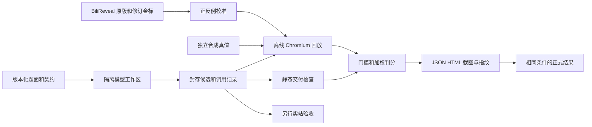

# 数据流与维护

- static.mjs：元数据与 AST，不用某个 Hook 关键字存在与否代替功能验证。
- monitor.mjs：先于候选记录请求、存储、弹窗和错误，GM 写入会留证。
- replay.mjs：模拟组件/页面生命周期和原生按钮，不访问账号或 B 站。
- data.mjs：seed 控制的 ID、属地、同用户多位置、诱饵、空字段、HTML 字符和复用；真值保留在 Node。
- assertions.mjs：穿透开放 Shadow DOM，逐条读取可见时间栏、矩形和按钮；不依赖金标私有标记。
- runner.mjs：每场景新上下文、路由阻断、环境和源码指纹、完整/局部测试资格。
- calibrate.mjs：双 seed 正例、原版/AI 诊断、六类错误变体。

金标固定 v2.3.0，构建离线且确定；输入/输出哈希和补丁保留。engineSha256 聚合 case、回放、断言、监测和依赖锁定；浏览器用系统版本并在报告记录，跨版本需重新校准。本项目没有捆绑整个 Chromium 二进制，跨机器不能只凭 package-lock 声称环境完全相同。

回放不是完整 Vue/Lit 内部，也不是完整用户脚本扩展。Closed Shadow Root、APP 签名、账号主页、专栏作者、直播弹幕位置均不在计分范围。CPU/内存维护风险可作为审计备注，目前不制造跨硬件的伪精确性能分。

新增实站资料先脱敏，形成“结构来源 → 合成字段 → case ID”证据链。扩大范围要变更题面和版本；公开模型输入不包含金标链接、源码和隐藏参数。
