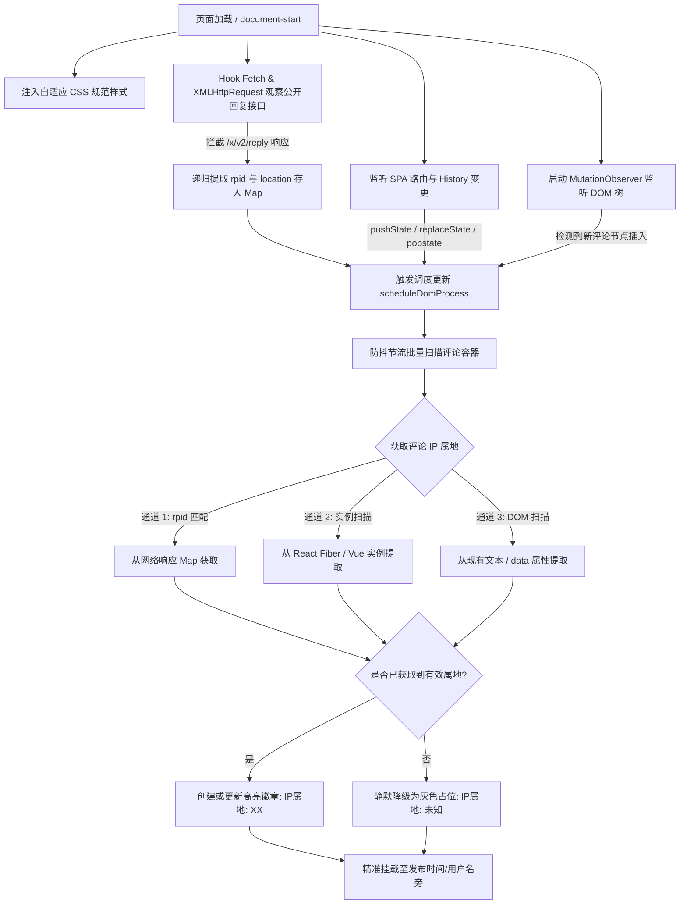

# Bilibili 评论区 IP 归属地显示油猴脚本

在哔哩哔哩（Bilibili）电脑端评论区（涵盖视频、动态、专栏、剧集、个人空间等）优雅展示公开数据中已返回的 IP 归属地信息。

---

## 🌟 核心特性

- **多层级数据捕获引擎**：
  - **网络层拦截**：无感劫持 `fetch` 与 `XMLHttpRequest`，监听 B 站官方回复接口（`/x/v2/reply` 相关端点），建立 `rpid -> IP 归属地` 内存映射。
  - **组件实例回溯**：深度遍历 React Fiber 树（`memoizedProps.reply`）与 Vue 组件实例，解析服务端预渲染或异步挂载的属地数据。
  - **DOM 兜底解析**：智能提取页面已渲染的属地文本与自定义元素属性。
- **全方位 SPA 动态路由支持**：
  - 拦截并监听 `history.pushState`、`history.replaceState`、`popstate` 与 `hashchange`。
  - 页面内部切换视频、打开子评论弹窗、切换分 P、跳转专栏等场景均能自动识别并实时更新。
- **高性能 MutationObserver 响应**：
  - 监听 DOM 树动态变动，配合 `requestAnimationFrame` 防抖与节流，即便滚动浏览上千条评论依然保持 60 FPS 流畅无卡顿。
- **原生级现代化 UI 排版**：
  - 严格遵循 B 站设计规范（字体、字号、圆角、行高与色彩体系）。
  - 自适应浅色主题、深色主题（Dark Mode）与 DarkReader。
  - 精准锚定在评论发布时间后方或用户名旁，防遮挡操作按钮与用户卡片浮层。
- **防重复与就地升级机制**：
  - 具备 `data-bili-ip-processed` 与节点存在性校验，杜绝多次渲染导致 DOM 重复插入。
  - 当接口数据延迟返回时，现有占位徽章可就地无缝升级为真实归属地。
- **零隐私泄露与最小权限原则**：
  - 声明 `@grant none`，无需任何跨域网络权限。
  - 绝不发起额外网络请求，不收集、不上传、不持久化任何用户隐私数据。
  - 仅读取官方公开接口中明确返回的 `location` 字段，不猜测、不推断精确位置。

---

## 📥 安装使用

### 1. 前置依赖
请确保浏览器已安装以下任意一款常见的用户脚本管理器扩展：
- [Tampermonkey (篡改猴)](https://www.tampermonkey.net/)
- [Violentmonkey (暴力猴)](https://violentmonkey.github.io/)
- [ScriptCat (脚本猫)](https://docs.scriptcat.org/)

### 2. 安装步骤
1. 打开脚本管理器控制台，点击 **“添加新脚本”** 或 **“新建”**。
2. 将 [`bilibili-ip.user.js`](bilibili-ip.user.js) 文件中的所有代码复制并粘贴到编辑器中。
3. 保存并启用脚本。
4. 打开任意 B 站视频、动态或专栏页面，滚动至评论区即可看到 IP 归属地标识（如 `IP属地：北京`）。

---

## 🏗️ 工作原理与架构设计

### 多通道提取逻辑解析

| 通道 | 提取源 | 适用场景 | 优势 |
| :--- | :--- | :--- | :--- |
| **通道 1：网络接口拦截** | `api.bilibili.com/x/v2/reply/*` | 滚动加载、展开二级评论、切换排序 | 100% 精确匹配 `rpid`，获取原始官方字段 |
| **通道 2：组件实例回溯** | `node.__reactFiber$...` / `node.__vue__` | 客户端首屏渲染、页面已预载评论 | 无需依赖网络捕获即可即时读取组件状态 |
| **通道 3：DOM 树回退解析** | `.reply-ip` / `[data-location]` / 文本正则 | 旧版评论系统、静态专栏页 | 全面兼容 B 站历史老旧页面与特殊专区 |

---

## 🎨 视觉与样式规范

- **字体大小**：`12px`
- **行高**：`16px`
- **默认文字色彩**：`#9499a0`（Bilibili 标准辅助文字灰）
- **占位/未知色彩**：`#c9ccd0` / 暗色模式 `#5b6068`
- **圆角与背景**：`border-radius: 4px`，浅灰色半透明胶囊背景
- **交互规范**：`user-select: none`，鼠标悬浮展示完整数据说明浮层，不阻碍评论区原有点击与跳转。

---

## 🔒 隐私与安全性声明

1. **零外部网络传输**：本脚本未申请 `@grant GM_xmlhttpRequest`，元数据声明 `@grant none`，在浏览器沙箱级别物理阻断向第三方服务器发送任何数据的可能。
2. **纯粹被动观察**：脚本对 `fetch` / `XHR` 的拦截采用只读克隆（`response.clone()`）机制，原请求与响应数据流完全透传，不对原页面通信造成任何影响或延迟。
3. **无持久化存储**：不向 `localStorage`、`IndexedDB` 或 Cookie 写入任何用户信息。

---

## 📄 许可证

本项目基于 MIT 许可证开源。
